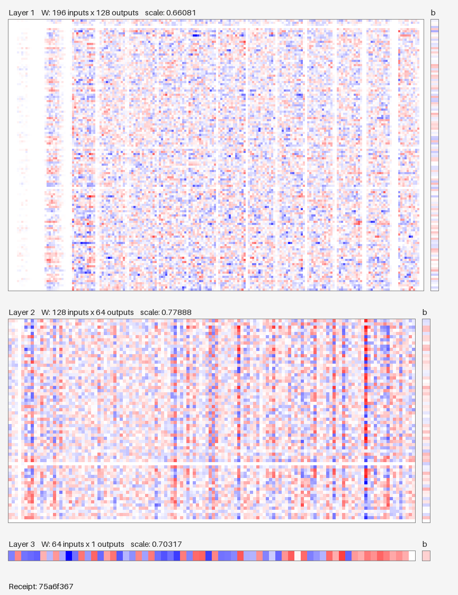

# 重み行列の画像から MNIST の対象数字を読めるか

数値列条件と同じ50個の分類器を画像化し、3モデルに計150回出題した。各問の選択肢は0〜9。設問・画像・採点方法をコミット `57e6eba` で固定してから、親履歴を継承しない新しいコンテキストで1回ずつ回答を収集した。各モデルの推論設定は medium。[事前条件](PROTOCOL.md) ・ [英語の設問](prompt.txt) ・ [各応答の原文](responses/) ・ [全問の採点表](trials.csv)

Astra は数値列 **38/50** から画像 **10/50** に低下した。画像での10正答の内訳は、隠れ層なしの線形分類器が **6/10**、隠れ層を持つ4構成の合計が **4/40**。Terra と Luna では、表示方法による正答率の差は5%水準で有意にならなかった。

## サイズごとの正答数

数値列 → **画像**。分母は各条件で手順に適合した試行数。

| パラメータ数 | gpt-6.2-astra | gpt-6.1-terra | gpt-6-luna |
|---|---|---|---|
| 197 | 9/10 → **6/10** | 2/10 → **3/10** | 0/10 → **1/10** |
| 793 | 10/10 → **1/10** | 2/10 → **0/10** | 2/9 → **1/10** |
| 6,337 | 8/10 → **0/10** | 1/10 → **2/10** | 1/9 → **0/10** |
| 7,393 | 6/10 → **1/10** | 2/10 → **2/10** | 1/9 → **2/8** |
| 33,537 | 5/10 → **2/10** | 3/10 → **1/10** | 1/7 → **0/9** |
| 全構成 | 38/50 → **10/50** | 10/50 → **8/50** | 5/44 → **4/47** |

## 同一チェックポイントでの比較

両条件で手順に適合した試行を照合した。p 値は、片方だけが正解だった問題について行った両側の正確 McNemar 検定。3モデルの検定を Holm 法で補正した。[集計CSV](paired.csv)

| モデル | 共通問題 | 両方正答 | 数値列のみ正答 | 画像のみ正答 | 両方誤答 | p | 補正 p |
|---|---|---|---|---|---|---|---|
| gpt-6.2-astra | 50 | 8 | 30 | 2 | 10 | 2.46e-07 | 7.39e-07 |
| gpt-6.1-terra | 50 | 3 | 7 | 5 | 35 | 0.774 | 1 |
| gpt-6-luna | 42 | 1 | 4 | 3 | 34 | 1 | 1 |

## 偶然水準との比較

全割当を分母とした正答率には、手順不適合の試行を失敗として含めた。検定は手順適合試行が対象。各構成内で対象ラベルを置換し、回答分布を固定した片側の正確確率を求めた。3モデルの Holm 補正は上の表示方法の比較とは別に行った。

| モデル | 正答 / 全割当 | 適合数 | 有効な数字 | p | 補正 p |
|---|---|---|---|---|---|
| gpt-6.2-astra | 10/50 | 50 | 50 | 0.0203 | 0.0609 |
| gpt-6.1-terra | 8/50 | 50 | 50 | 0.105 | 0.211 |
| gpt-6-luna | 4/50 | 47 | 47 | 0.741 | 0.741 |

画像条件では Luna の3件を除外した。2件は回答者が画像を受け取れなかったと報告し、1件は運営役に回答を追加送信した。運営役は返信しなかった。数値列条件では Luna の追加送信6件を除外した。手順適合後の形式無効は誤答として数えた。受領符号は画像の受領を確認するもので、すべての画素に注意を向けたかは測定していない。共有ファイル環境での分離は指示によるもので、各回答者の全ツール操作を OS レベルで独立監査した実験ではない。

画像条件だけの全構成を合わせて10択の偶然水準と比較すると、3モデルとも Holm 補正後の5%水準には達しなかった。Astra の補正前 p 値は0.0203、補正後は0.0609だった。この結果だけで画像に識別の手掛かりがないとは判断できない。

## 実際の出題画像と回答

下図は前回と同じ、対象が「7」の33,537パラメータの分類器。識別用のIDと受領符号は対象数字を示さない。試行時に見せたのはこのPNGと設問のみ。

| モデル | 数値列の回答 | 画像の回答 |
|---|---|---|
| gpt-6.2-astra | 7 | 7 |
| gpt-6.1-terra | 2 | 8 |
| gpt-6-luna | 8 | 2 |

## 画像が保存している情報

各層で入力を横、出力ユニットを縦に並べ、右に全バイアスを載せた。最大構成では重み行列が196×128、128×64、64×1。各層の重み・バイアスの最大絶対値を画像に記載し、共通の尺度で白を0、赤を正、青を負として511段階に丸めた。表示時は最近傍で拡大した。元の数字の画像や分類出力例は渡していない。

採点側の検算で、実際の50枚のPNGから全482,570個の値を読み戻した。どの値も、元の数値との差はその層の色1段階の半分以内だった。復元した分類器の二値判定は、公式テスト画像1万枚 × 50個で **499,855/500,000（99.971%）** が元の数値列と一致した。[PNGの復号と検算](verify_images.py) ・ [分類器別の照合結果](encoding_check.csv)

数値列では入力重みを14画素ごとに改行した。画像条件では196画素を横1列に並べ、値も色に丸めた。観測した差には、表現、画素の並べ方、精度が同時に関わる。各サイズ・各数字につき1分類器、各条件で1回答のため、一般に認識できるパラメータ数の境界は推定できない。
