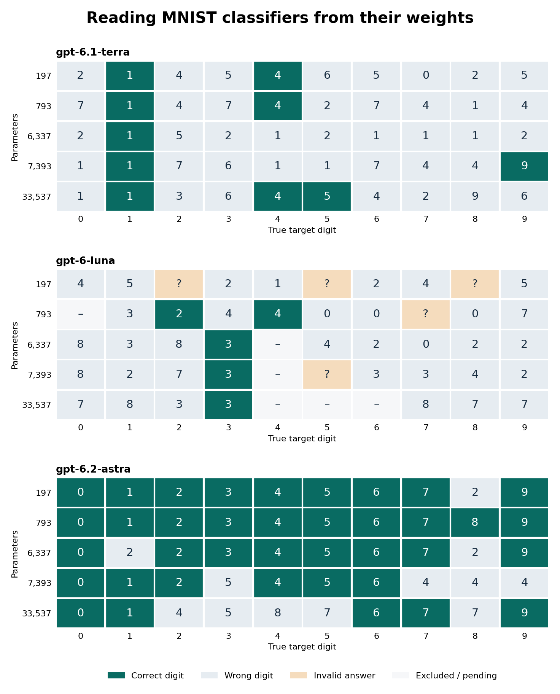
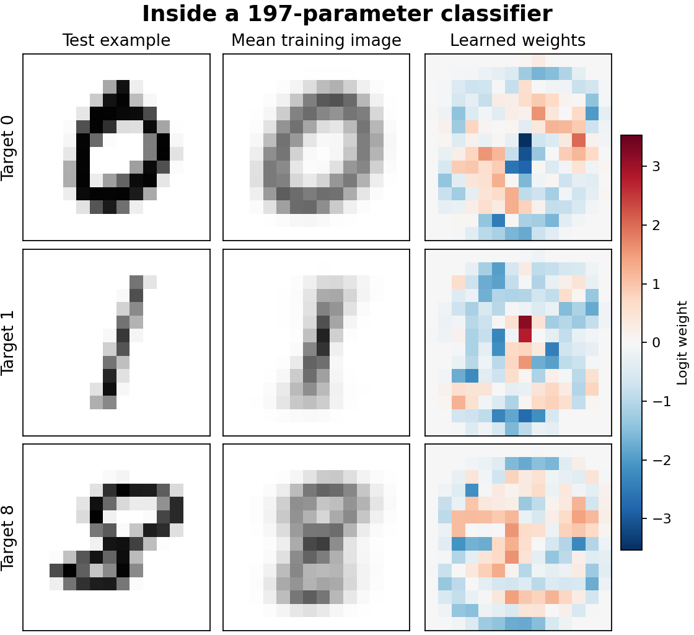

# 重みの数値列から、分類器の目的を読めるか

## Astra を加えた3モデルの比較

同じ72問を **gpt-6.2-astra** に追加出題した。Terra と Luna の数値は先行実験の記録を再採点したもの。問題・重み・英語プロンプト・受領符号・medium の推論設定・採点基準は共通。Astra の初回72試行には72個の別々の回答コンテキストを使用し、72件が手順に適合した。[勉強会スライド](../slides/index.html) ・ [追加試行の事前条件](../ASTRA_PROTOCOL.md) ・ [Astra の全回答](gpt-6.2-astra/)

| MNIST のパラメータ数 | 6.2-astra | 6.1-terra | 6-luna | Astra の補正後 p 値 |
|---:|---:|---:|---:|---:|
| 197 | 9/10 | 2/10 | 0/10 | 2.2e-06 |
| 793 | 10/10 | 2/10 | 2/9 | 1.38e-06 |
| 6,337 | 8/10 | 1/10 | 1/9 | 4.96e-06 |
| 7,393 | 6/10 | 2/10 | 1/9 | 0.000106 |
| 33,537 | 5/10 | 3/10 | 1/7 | 0.00234 |
| **合計** | **38/50** | **10/50** | **5/44** | |

数字同定の分母は手順適合試行。3モデルに共通する44問でも、Astra 34問、Terra 8問、Luna 5問の正答だった。Luna の除外6問も含める感度分析では5/50。Astra は全5サイズで10択の偶然水準を上回った（各サイズで予測を固定した正解ラベルの片側置換検定、5サイズの Holm 補正、5%水準）。[サイズ別検定](recognition.csv) ・ [同じ問題でのモデル比較](paired_models.csv)

| 初回の課題 | 6.2-astra | 6.1-terra | 6-luna |
|---|---:|---:|---:|
| 7セグメント表示の対象数字（正答 / 適合） | 10/10 | 10/10 | 10/10 |
| 4ビット局所編集（成功 / 適合） | 4/4 | 4/4 | 2/4 |
| MNIST 出力反転・793（適合かつ全値一致 / 割当） | 4/4 | 4/4 | 4/4 |
| MNIST 出力反転・33,537（適合かつ全値一致 / 割当） | 4/4 | 4/4 | 1/4 |

Astra は最大の33,537パラメータの出力反転4問すべてで、最終層の65値が一致し、1万枚の画像で最大絶対誤差は0だった。同じ規模のターゲット同定は5/10。「7」の比較用チェックポイントでの回答は「7」。この例は先行する2モデルの報告で用いたもので、Astra の回答を見る前から同じものを使用した。[編集結果](inversion.csv) ・ [「7」での Astra の回答](gpt-6.2-astra/0bd23458ac578ebf.json)

各サイズは1数字1ネット・各モデル1回答で、識別に使われた個別の重みは測定していない。回答役には他の問題の履歴や正解を渡さず、担当ファイルの表示だけを許可した。運営側で確認できるのは配信設定、返答と受領符号、運営役への追加送信である。ファイルシステムは共有され、各回答役の全ツール呼び出しを独立に監査した実験ではない。

---

## 先行実験（6.1-terra と 6-luna）

2026年11月19日。各問を新しいサブエージェントに割り当て、**gpt-6.1-terra** と **gpt-6-luna** に同じ学習済みチェックポイントを提示した。正解や前の回答は回答役に渡さず、重みは行順どおりの数値テキストとして提示した。[問題の事前固定](../PROTOCOL.md) ・ [学習・配信・再現手順](../README.md)

**両モデルとも8パラメータの7セグメント判定器を10/10問で読み解き、33,537パラメータのMNISTネットの最終層を正確に編集できた。一方、MNISTの対象数字を重みだけで答える成績は、6.1-terra が10/50、6-luna が5/44だった。** 以下のサイズ別結果は、ネットの目的を推定する課題と、作用を指定された層を数値編集する課題で成績が異なることを示す。

## MNIST の対象数字を推定

正答数の分母は手順に適合した試行数。各構成について0〜9を1問ずつ出題した。無作為な10択の正答率は10%。NN の balanced accuracy は、実際に提示した小数を読み戻したネットの感度と特異度の平均で、各構成10個の平均を示す。

| パラメータ | 入力→隠れ層→出力 | NN の balanced accuracy | NN の AUROC | 6.1-terra 正答 | 6-luna 正答 |
|---:|---|---:|---:|---:|---:|
| 197 | 196→1 | 95.30% | 0.9864 | 2/10 | 0/10 |
| 793 | 196→4→1 | 96.63% | 0.9925 | 2/10 | 2/9 |
| 6,337 | 196→32→1 | 98.41% | 0.9984 | 1/10 | 1/9 |
| 7,393 | 196→32→32→1 | 98.65% | 0.9985 | 2/10 | 1/9 |
| 33,537 | 196→128→64→1 | 98.94% | 0.9992 | 3/10 | 1/7 |
| **合計** | | | | **10/50 (20.0%)** | **5/44 (11.4%)** |

両モデルとも手順に適合した同じ44問に絞ると、6.1-terra は8問、6-luna は5問に正解した。両方正解は1問。6-luna の適合試行には数字が返らないなどの無効回答5件があり、すべて誤答に数えた。除外した6件はいずれも、回答役が最終回答前に別の送信ツールで運営役へ予想を伝えたものだった。全片の受領符号は合致し、運営役からの返信はなかった。これらの回答も採点する感度分析では **5/50 (10.0%)** となった。[個別予測](trials.csv) ・ [同一問題比較](paired.csv) ・ [手順逸脱](deviations.jsonl) ・ [感度分析](sensitivity.csv)

### 偶然正答との比較

事前指定した検定では、10問揃った構成ごとに予測を固定し、正解ラベルの10!通りの並べ替えを用いて、観測以上の正答数になる片側確率を計算した。モデルごとに5サイズの Holm 補正を適用し、全問揃わなかったサイズは検定を見送った。6.1-terra で最も低い p 値は33,537パラメータの **0.0741、補正後0.3704**。6-luna で全10問が適合した197パラメータは p=1。送信操作のあった回答まで含めた感度分析でも、両モデルの各サイズの未補正 p 値はすべて0.05を上回った。[サイズ別検定](recognition.csv)

追加の探索的集計では、全サイズで同じ数字を対応づけ直す置換検定も行った。同じ数字が複数のサイズに登場する依存関係を保つ。6.1-terra の10正答に対し偶然期待値は5.0、片側 p=0.0453、2モデルの Holm 補正後0.0907。6-luna は有効な数字を返した39問からの偶然期待値3.9、観測5、p=0.3507。6.1-terra が数字の手掛かりを一部拾った可能性は残る。どの条件でも1サイズ10問、1数字1チェックポイントで、安定した認識の上限を特定できる精度はない。[探索的集計](pooled_exploratory.csv)

### 分類器の動作からは対象を回収できる

独立の外部対照として、各数字につき公式テスト画像を先頭から5枚ずつ使い、平均ロジットが最大となる数字を選んだ。**50/50** の分類器で真の対象を特定できた。回答役には画像、可視化、出力ロジットを提示していない。下図では197パラメータの線形分類器3個を可視化した。たとえば「0」の中央には、それだけインクが増えると「0」の得点を下げる負の重みが見える。[個別の対照結果](probe.csv)

## 4ビットネットの局所編集

1個の入力ビットについて、指定された出力だけがビット反転後の値を返すよう、最大2個の数値を変更させた。各問で全16入力と両出力の32値を照合した。6.1-terra は **4/4問、128/128値**、6-luna は **2/4問、96/128値**。元の重みのままでは0/4問・64/128値、構成的に求めた参照編集では4/4問・128/128値だった。[採点結果](editing.csv)

最初の問題では、ある隠れユニットの値が 1.25 × x₃ で、変更対象の出力に −2 × x₃ を寄与していた。x₃ を反転したときの寄与は −2 + 2 × x₃。両モデルとも対応する重みを −1.6 から +1.6、バイアスを 7 から 5 に変え、全32値が合った。6-luna が失敗した別の2問では、対応する重みの符号を正しく反転し、必要なバイアス変更を省略した。最大絶対誤差はそれぞれ5と4だった。[設問](../edits/prompts/17c2926789ec.txt) ・ [6.1-terra の回答](gpt-6.1-terra/17c2926789ec.json) ・ [6-luna の回答](gpt-6-luna/17c2926789ec.json)

## 大きな MNIST 分類器の数値編集

既存の分類器に対し、すべての入力の出力ロジットが元の負になるよう、最後のユニットの重みとバイアスを数値で再提出させた。元の値と位置ごとに照合した後、実際に置き換え、公式テスト画像1万枚でも最大絶対誤差を測った。この追加課題の判定基準と対象チェックポイントは、同課題の最初の回答を収集する前に固定した。[追加実験の仕様](../inversion/README.md)

| ネット全体 | 提出する数値 | 6.1-terra 完全一致 / 割当 | 6-luna 手順適合かつ完全一致 / 割当 | 6-luna 完全一致 / 手順適合 |
|---:|---:|---:|---:|---:|
| 793パラメータ | 5 | 4/4 | 4/4 | 4/4 |
| 33,537パラメータ | 65 | 4/4 | 1/4 | 1/1 |

完全一致した手順適合試行はすべて、テスト画像1万枚で最大絶対誤差0だった。最大構成の6-luna の初回4件では、1件が手順に適合、2件は余分な送信操作で除外、1件は21片中8片で配信を打ち切り数値未提出。除外2件の提出値も全65値が正しかった。したがって、手順を問わず初回に正しい具体値が返ったのは **3/4** である。[初回の数値照合](inversion.csv)

受領が不完全だった1件だけを同じ問題・同じ推論設定の新規コンテキストで再試行した。21/21片を受領し、65/65値が完全一致、1万画像の最大絶対誤差は0。再試行は初回の表に加えていない。運営役がこの再試行の受領符号を1個重複して転記したため、回答役の最終出力と照合して訂正した。初回のMNIST同定でも、回答本文が不正な JSON の場合に受領確認まで失敗扱いにする記録処理を修正し、本文の有効性と受領符号を独立に再検証した。[再試行の生回答](retries/gpt-6-luna/2fe1964d880f700f.json) ・ [再試行の数値照合](inversion_retries.csv)

**同じネットワークでも、問いによって結果が変わった。** 「7」の33,537パラメータの分類器では、対象数字を 6.1-terra は「2」、6-luna は「8」と回答した。別の新規コンテキストで同じチェックポイントの出力反転を指示すると、両者とも65値をすべて正しく変更した。最後のユニットがアフィン変換なので、最後の重みとバイアスの符号を一括で反転すれば、前段の各ユニットの意味を推定せずに課題を達成できる。[元の分類器](../fixtures/prompts/0bd23458ac578ebf.txt) ・ [6.1-terra の編集](gpt-6.1-terra/0cadce6353adeecb.json) ・ [6-luna の編集](gpt-6-luna/0cadce6353adeecb.json)

## 8パラメータなら同じ数字同定で何ができたか

7セグメント表示の各位置を説明し、学習済み線形ユニットの7つの重みとバイアスから、対象数字を10択で答える追加対照を行った。**両モデルとも10/10問に正解した。** 例えば「7」のネットは、上・右上・右下に +2、残りに −2、バイアスに −5 を持つ。最初の3本だけを点灯させると得点は +1 で、どれか1本でも違うと負になる。丸めた全10ネットについて計1,280通りの入力・出力を検証した。[対照課題の成績](segment.csv) ・ [「7」の設問](../segment/prompts/0a35445ba13982da.txt)

## 結果の範囲

試した範囲では、対応する部品が明確な8パラメータの判定器を読み解く能力と、33,537パラメータのネットに含まれる最終層を正確に編集する能力を観測した。学習済み MNIST ネット全体から対象数字を一貫して推定できるサイズの境界は特定できなかった。7セグメントと MNIST では入力の意味、訓練分布、重みの構造も変わる。8と197の間をパラメータ数だけに起因する境界と解釈することはできない。

実施条件は英語の問題文、medium の推論設定、各モデル・各チェックポイントにつき初回1回答。各問のサブエージェントは親履歴を継承せず、初回で計144個の異なる回答コンテキストを照合した。受領符号は配信の確認に使った。内部で全パラメータを同時に利用したかは測っていない。許可した操作は担当ファイルを表示することだけだが、共有ファイルシステム上の正解ファイルへのアクセスを OS で禁止する構成ではない。重み文字列を解析するコードや画像を回答役には提供していない。[6.1-terra の生回答](gpt-6.1-terra/) ・ [6-luna の生回答](gpt-6-luna/)
